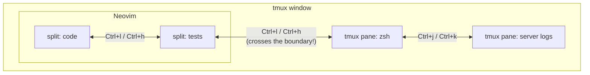
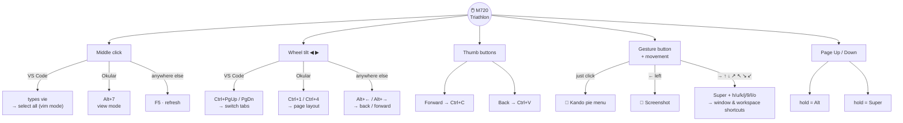
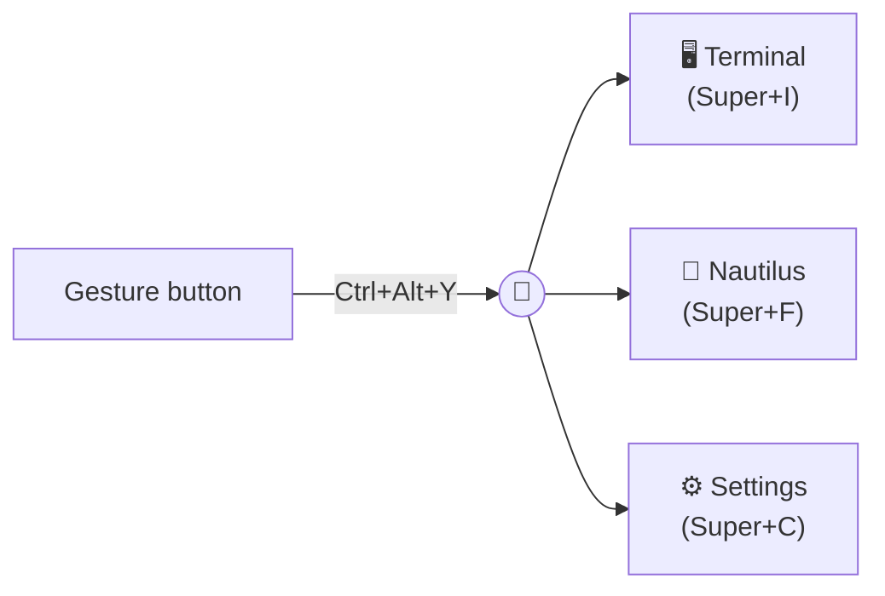

<div align="center">

# ~/.dotfiles

**My Linux setup: a terminal-centric, keyboard-first (and mouse-gesture-powered) workflow on Ubuntu + GNOME.**




<sub>🎨 Themes: <b>Rosé Pine</b> (terminal & prompt) · <b>Catppuccin Mocha</b> (Neovim & tmux)</sub>

</div>

---

## 📑 Contents

- [The stack](#-the-stack)
- [Highlights: the fun parts](#-highlights-the-fun-parts)
  - [Ctrl + h j k l everywhere](#1--ctrl--h-j-k-l-everywhere-tmux--neovim-as-one)
  - [The mouse is a command center](#2-️-the-mouse-is-a-command-center-solaar-rules)
  - [Pie menu on a mouse button](#3--a-pie-menu-on-a-mouse-button-kando)
  - [Neovim](#4--neovim)
  - [Shell superpowers](#5--shell-superpowers)
  - [Small hacks](#6--small-hacks-that-make-a-big-difference)
- [GNOME extensions](#-gnome-extensions)
- [Repository layout](#-repository-layout)
- [Install](#-install)
- [Credits](#-credits)

---

## 🧰 The stack

| Category | Tool | Why |
|---|---|---|
| **OS / DE** | Ubuntu + GNOME | Stable base, heavily extended (see [extensions](#-gnome-extensions)) |
| **Terminal** | [Alacritty](https://alacritty.org) | GPU-accelerated, no window decorations, Rosé Pine theme |
| **Multiplexer** | [tmux](https://github.com/tmux/tmux) + [TPM](https://github.com/tmux-plugins/tpm) | Sessions, splits, Catppuccin status bar on **top** |
| **Shell** | Zsh | + `zsh-autosuggestions` + `fast-syntax-highlighting` |
| **Prompt** | [Starship](https://starship.rs) | Two-line Rosé Pine prompt with language versions |
| **History** | [Atuin](https://atuin.sh) | SQLite-backed shell history, fuzzy search, filtered by directory |
| **Navigation** | [zoxide](https://github.com/ajeetdsouza/zoxide) · [Yazi](https://yazi-rs.github.io) | Smart `cd`, plus a terminal file manager |
| **Editor** | [Neovim](https://neovim.io) + [lazy.nvim](https://github.com/folke/lazy.nvim) | 29 plugins, LSP, Telescope, Copilot |
| **Font** | MesloLGS Nerd Font Mono | Icons in the prompt, tmux and Neovim |
| **Mouse** | Logitech M720 Triathlon + [Solaar](https://github.com/pwr-Solaar/Solaar) | 20+ custom rules: per-app buttons and gestures |
| **Launcher** | [Kando](https://kando.menu) | Pie menu opened from the mouse's gesture button |
| **Automation** | AutoKey · imwheel | Python scripts on key events, faster scroll wheel |
| **Fetch** | hyfetch / neowofetch | Because every dotfiles repo needs one 😄 |

---

## ✨ Highlights: the fun parts

### 1. 🧭 Ctrl + h j k l everywhere (tmux ⇄ Neovim as one)

Thanks to `vim-tmux-navigator` (tmux side) and `nvim-tmux-navigation` (Neovim side), **moving between Neovim splits and tmux panes uses the same keys**. The cursor doesn't care where one program ends and the other begins.



Since `Ctrl+l` is taken for navigation, **`Ctrl+g` clears the screen** instead (`bind-key -n C-g send-keys C-l`).

<details>
<summary><b>tmux cheatsheet</b></summary>

| Key | Action |
|---|---|
| `Ctrl+s` | **Prefix** (replaces the default `Ctrl+b`) |
| `prefix` `r` | Reload `~/.tmux.conf` |
| `prefix` `h/j/k/l` | Select pane left/down/up/right |
| `Ctrl+h/j/k/l` | Move across panes **and** Neovim splits |
| `Ctrl+g` | Clear screen (stands in for `Ctrl+l`) |
| `prefix` `[` | Copy mode with **vi keys** |
| mouse | Enabled: click, resize, scroll |

</details>

---

### 2. 🖱️ The mouse is a command center (Solaar rules)

Linux has no official Logitech software, so I wrote my own button logic with **Solaar rules** ([`solaar/.config/solaar/rules.yaml`](solaar/.config/solaar/rules.yaml)). The same physical button **does different things depending on the focused app**:



**Copy/paste with my thumb**, switching VS Code tabs by tilting the wheel, and 8-direction gestures mapped to GNOME shortcuts. The `hold Page Up = Alt` trick turns the mouse into a modifier key, so `hold + scroll` and `hold + click` combos come free.

---

### 3. 🥧 A pie menu on a mouse button (Kando)

[Kando](https://kando.menu) draws a radial menu under the cursor. Clicking the gesture button (→ `Ctrl+Alt+Y`) opens it; then a flick picks Terminal, Files or Settings.



Starts on login (`autostart/kando.desktop`), integrated with GNOME through the `kando-integration` extension. Kando even keeps achievements, and mine say **364 selections** and counting. 🏆

---

### 4. 📝 Neovim

Modular config: [`init.lua`](nvim/.config/nvim/init.lua) bootstraps **lazy.nvim**, and each plugin lives in its own file under `lua/plugins/`.

<details open>
<summary><b>Plugins (29, pinned in <code>lazy-lock.json</code>)</b></summary>

| Area | Plugins |
|---|---|
| 🎨 UI | `catppuccin` (mocha, transparent bg) · `lualine` · `alpha-nvim` (ASCII splash) · `nvim-web-devicons` |
| 🔭 Find | `telescope` + `telescope-ui-select` |
| 📂 Files | `neo-tree` (sidebar) · `oil.nvim` (edit the filesystem like a buffer) |
| 🧠 LSP | `mason` · `mason-lspconfig` · `nvim-lspconfig` (lua_ls, tailwindcss, ruby_lsp) |
| ⌨️ Completion | `nvim-cmp` · `LuaSnip` · `friendly-snippets` · Copilot |
| 🌳 Syntax | `nvim-treesitter` |
| 🔀 Git | `vim-fugitive` · `gitsigns` · `lazygit.nvim` |
| 🧪 Tests | `vim-test` + `vimux` (tests run in a tmux pane) |
| 🧰 Misc | `vim-surround` · `swagger-preview` · `nvim-tmux-navigation` |

</details>

<details>
<summary><b>Keymaps</b> (leader = <kbd>Space</kbd>)</summary>

| Key | Action |
|---|---|
| `Ctrl+p` | Find files (Telescope) |
| `␣ f g` | Live grep |
| `␣ ␣` | Open buffers |
| `Ctrl+n` | Toggle Neo-tree |
| `␣ b f` | Floating buffer list |
| `-` | Oil, floating file editor |
| `␣ l g` | LazyGit |
| `K` / `␣ g d` / `␣ g r` | Hover · go to definition · references |
| `␣ c a` / `␣ r n` / `␣ g f` | Code action · rename · format |
| `␣ g p` / `␣ g t` | Preview git hunk · toggle line blame |
| `␣ t` / `␣ T` / `␣ a` | Test nearest · file · whole suite |
| `vie` | **Select the entire buffer** (custom "text object") |
| `die` | **Delete the entire buffer** |
| `Ctrl+c` / `Ctrl+v` | Yank to / paste from system clipboard |
| `␣ h` | Clear search highlight |

</details>

---

### 5. 🐚 Shell superpowers

- **Starship** prompt ([`starship.toml`](starship/.config/starship.toml)): a custom `rose-pine` palette with pill-shaped segments for user, directory (with icon substitutions for `Documents`, `Downloads`…), git branch and the **runtime version** of C, Elixir, Elm, Go, Haskell, Java, Julia, Node, Nim, Rust, Scala and Python (incl. virtualenv). A `$fill` pushes the clock to the right, and the input goes on its own line.
- **Atuin** replaces `Ctrl+R`/`↑` with a searchable SQLite history. The `↑` key is **filtered to the current directory**, so in a project folder you see that project's commands first.
- **zsh-autosuggestions** + **fast-syntax-highlighting**: fish-like suggestions and live coloring while typing.
- **zoxide** jumps to frequently used directories with `z <part-of-name>`.
- **Yazi** opens files in VS Code or Neovim straight from the file manager.

---

### 6. 🔧 Small hacks that make a big difference

| Hack | File | What it does |
|---|---|---|
| ⚡ Fast scroll | [`.imwheelrc`](imwheel/.imwheelrc) | Multiplies the scroll wheel ×10 in every app |
| 🧾 Alacritty scroll keys | [`alacritty.toml`](alacritty/.config/alacritty/alacritty.toml) | `Ctrl+O/I` scroll line by line, `Ctrl+Shift+O/I` jump to top/bottom, `Shift+Enter` sends `ESC+CR` (newline in TUI chats) |
| 📋 Select = copy | `alacritty.toml` | `save_to_clipboard = true` |
| ⌨️ Auto layout switch | [`layout.py`](autokey/.config/autokey/data/scripts/layout.py) | AutoKey script: detects when **VS Code or Alacritty** starts and switches the keyboard layout (`Super+Space`) for coding |
| 👁️ Vim focus fix | [`.vimrc`](vim/.vimrc) | Drops back to Normal mode when the window loses focus |
| 🎨 Theme swap | `alacritty/` | Rosé Pine (main/moon/dawn) and Catppuccin Mocha ready, change one `import` line |

---

## 🧩 GNOME extensions

Listed in [`gnome/extensions.txt`](gnome/extensions.txt):

| Extension | Purpose |
|---|---|
| Blur my Shell | Blurred panel/overview |
| Dash to Dock | Dock on the side |
| Rounded Window Corners | Every window gets rounded corners |
| Highlight Focus | Border around the focused window |
| Mouse Follows Focus · Focus Follows Workspace | The pointer jumps along with keyboard focus |
| Improved Workspace Indicator | Numbered workspaces in the top bar |
| Multi Monitors Add-On | Panel on every monitor |
| NoAnnoyance | Focuses new windows instead of "X is ready" |
| Solaar extension · Kando integration | Glue for the mouse setup above |
| Logo Menu · Toggler · User Themes | Small quality-of-life tweaks |

---

## 🗂️ Repository layout

Each folder is a **[GNU Stow](https://www.gnu.org/software/stow/) package** that mirrors `$HOME`, so `stow nvim` creates `~/.config/nvim → ~/dotfiles/nvim/.config/nvim`.

```
dotfiles/
├── alacritty/.config/alacritty/   # terminal + 4 color themes
├── atuin/.config/atuin/           # shell history
├── autokey/.config/autokey/       # python automation scripts
├── imwheel/.imwheelrc             # scroll speed
├── kando/.config/kando/           # pie menu + autostart entry
├── nvim/.config/nvim/             # init.lua + lua/plugins/*.lua
├── solaar/.config/solaar/         # mouse rules
├── starship/.config/starship.toml # prompt
├── tmux/.tmux.conf
├── vim/.vimrc
├── yazi/.config/yazi/
├── gnome/extensions.txt
├── assets/                        # README images
└── install.sh
```

---

## 🚀 Install

```bash
sudo apt install stow git
git clone https://github.com/Victor-0liveira/dotfiles ~/dotfiles
cd ~/dotfiles

./install.sh              # everything
./install.sh nvim tmux    # only some packages
./install.sh -D nvim      # remove the symlinks
```

Then:
1. Open **tmux** and press `Ctrl+s` `I` to install the plugins via TPM.
2. Open **Neovim** once. lazy.nvim installs itself and every plugin.
3. Install a [Nerd Font](https://www.nerdfonts.com/) (MesloLGS) so the icons render.

> ⚠️ Stow won't overwrite existing files, so back up your current configs first.

---

## 🙏 Credits

- Neovim structure inspired by [Typecraft](https://www.youtube.com/@typecraft_dev)'s "Neovim for Newbs" series
- Color schemes: [Rosé Pine](https://rosepinetheme.com) & [Catppuccin](https://catppuccin.com)
- And the countless r/unixporn posts that cost me hours of productivity 🐧

<div align="center">
<sub>Made with ☕, <code>:wq</code>, and way too much time on configs, by <a href="https://github.com/Victor-0liveira">Victor Oliveira</a></sub>
</div>
